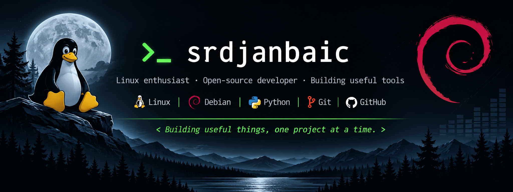

  

# 👋 Hey, I'm Srdjan

  <b>Linux enthusiast · Open-source developer · Building useful tools</b>

I build tools and desktop applications with a focus on Linux, usability and practical solutions. I enjoy turning ideas into software that makes everyday tasks simpler.

---

### 🛠️ What I work on

- 🐧 Linux & Debian utilities
- 🖥️ Desktop applications
- 🐍 Python development
- 🌍 Open-source projects

### 🚀 Featured Projects

| Project | Description |
|---|---|
| [Debian Maintenance Center](https://github.com/srdjanbaic/debian-maintenance-center) | Tools for managing and maintaining Debian systems. |
| [Debian System Care](https://github.com/srdjanbaic/debian-system-care) | A Linux system care and maintenance project. |
| [ScreenGlow](https://github.com/srdjanbaic/ScreenGlow) | A Python-based project. |
| [FotoFlux](https://github.com/srdjanbaic/FotoFlux) | A Linux desktop photo editor featuring AI-powered selective blur. |

### 💻 Tech & Tools

  

### 📊 GitHub Stats

  
  

---

  <i>Building useful things, one project at a time.</i>

  

